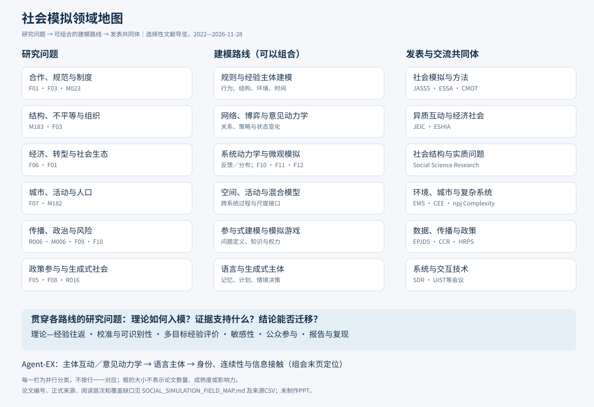

# 社会模拟领域文献地图：研究脉络、近期进展与发表共同体

组会汇报底稿｜更新：2026-11-28｜近期文献窗口：2022-01-01—2026-11-28

## 汇报的中心问题

**社会模拟研究的是：个体、组织与制度怎样通过互动产生集体现象，以及改变这些过程后会发生什么。** 它的价值既包括解释机制，也包括比较情景、检验理论、辅助政策讨论和研究复杂系统的可能行为。

这份地图采用“研究问题—建模路线—证据—发表共同体”四层结构。LLM是近期重要分支，传统规则模型、经验ABM、经济与社会生态模型继续承担大量实质问题。本文是面向组会的选择性领域导览，不是全领域计量排名或系统综述。原有241条方法导向文献库用于提供已读证据，不作为全领域论文分布的抽样框；本次补入领域锚点，原库不重建、不改变纳入等级。

配套：[代表文献与来源](data/social_simulation_field_sources.csv)｜[研究主题矩阵](data/social_simulation_field_map.csv)｜[12页组会结构与讲述要点](reports/social_simulation_group_meeting_outline.md)｜[本次检索范围](reports/social_simulation_field_map_search_2026-11-28.md)。

图中各列为并行分类，不逐行对应，框的大小不表示学术份额。

## 1. 先划清领域边界

社会模拟是一类研究取向，ABM是一类建模方法，二者高度重叠但并不等同。ABM也用于纯生物或工程系统；采用机器学习、多个Agent或自然语言，也不自动构成社会模拟。

|路线|怎样表示社会过程|适合回答的问题|需要特别检查|
|---|---|---|---|
|主体建模／ABM|异质主体、规则、环境及互动|微观行为如何形成宏观模式；制度改变如何传播|行为规则、互动结构、初始化与更新顺序|
|网络、演化博弈与意见动力学|关系结构、策略／意见状态及转移|扩散、合作、规范、协调与分化的条件|网络和实际接触是否一致；规则有何经验依据|
|系统动力学|存量、流量、反馈与时滞|累积效应、反馈回路、长期政策情景|聚合尺度是否掩盖异质性；反馈是否有依据|
|微观模拟／人口模拟|个体或家庭属性与生命历程转移|人口、福利、税收、健康分布及其变化|代表性、转移率、行为反馈和分布验证|
|混合与耦合模拟|连接ABM、统计、机器学习及领域过程模型|经济—能源—气候、城市—交通—健康等跨系统反馈|模型接口、尺度、误差传播与重复计量|
|参与式建模与模拟游戏|让利益相关者参与问题、规则和情景构建|协商、地方知识、政策可接受性与共同学习|谁被代表、谁能影响规则、参与是否持续|

上述路线可以组合，不能排成由“低级规则”到“高级LLM”的单线技术阶梯。合成问卷回答通常属于个体层测量或替代问题；只有进一步组织互动、环境与时间过程，才进入闭环社会模拟。用于协作写代码的多Agent系统也应与模拟社会过程区分。

概念入口是Dilaver与Gilbert（2023）的五要素：主体能动性、社会结构、环境、行动与互动、时间性。它有助于在不同技术之间寻找可比较的研究对象。[概念框架，F02](https://www.jasss.org/26/1/4.html)

## 2. 领域怎样走到今天

以下是组织汇报的解释性脉络，**不是已经完成文献计量验证的分期**。各条路线一直并存，2022年以前的经典仅作历史背景，不计入本轮近期文献。

|脉络|核心关切|延续到今天的问题|
|---|---|---|
|早期机制与涌现研究（范围外背景）|简单局部规则能否产生隔离、合作、市场或集体秩序|能“生成”某种模式，是否足以解释现实？|
|行为、制度与社会结构进入模型|主体不只按同一规则行动；规范、信任、学习和组织影响选择|理论概念如何转化为可执行规则？|
|经验资料与政策应用深化|实验、调查、行政资料和数字痕迹用于初始化、估计和评价|拟合了什么；能否预测新时间、人群和干预？|
|混合模型与计算推断发展|跨系统耦合、代理模型、贝叶斯推断和大规模计算|效率提高后，可识别性与不确定性是否得到处理？|
|语言与生成式主体扩展|文本、记忆、计划和情境化决策进入主体行为|语言可信、行为匹配和群体过程有效能否同时成立？|

2022年的Betz已经用神经语言模型模拟自然语言论辩，说明语言主体路线早于2023年生成式Agent热潮；2023年的Generative Agents则把记忆、反思和计划组织成可交互小镇。二者的研究目标不同，不能把后者当作整个社会模拟领域的起点。[R006](https://www.jasss.org/25/1/2.html)、[R016](https://doi.org/10.1145/3586183.3606763)

2026年的THEMP提出显式结合理论和经验的建模过程。它提醒我们：经验化并不意味着放弃理论，理论探索也不意味着可以不解释模型与资料的关系。[F04](https://www.jasss.org/29/4/6.html)

## 3. 研究问题地图：领域在研究什么

|研究板块|典型问题|常见建模路线|本次代表入口|
|---|---|---|---|
|合作、规范与集体行动|信任、不平等、沟通和制度如何影响资源共享？|实验驱动规则ABM、演化博弈、认知主体|F01（2022）、F03（2024）、M023（2025）、F04（2026）|
|社会结构与不平等|微观选择、流动与组织过程如何积累成机会差距？|经验ABM、生命历程与空间模型|M183教师质量差距（2023）；F03制度参与与分配|
|经济、市场与组织|异质预期、企业、银行和政府互动如何产生波动？|宏观金融ABM、人工市场、组织网络、耦合模型|F06气候转型与宏观金融（2026）|
|城市、交通与人口|人的活动和位置如何形成城市流动与资源压力？|空间ABM、合成人口、活动模型、微观模拟|M182日常活动（2024）、F07城市活动（2026）、F11人口投影（2025机构报告）|
|环境、资源与社会生态|认知、制度和生态反馈如何共同决定适应与转型？|社会生态ABM、参与式模型、系统耦合|F01公共资源、F03危机分配、F06转型|
|健康、风险与应急|行为反应、接触网络和政策如何影响风险传播？|接触网络／疫情ABM、健康微观模拟、行为反馈|F09 COVSIM（2024）、F10疫情演练（2024）、F12公共健康反馈综述（2026）|
|传播、政治与公共讨论|信息、论辩、关系和平台规则怎样改变集体意见？|意见动力学、网络ABM、自然语言与平台模拟|R006（2022）、M006论坛验证（2026）|
|政策设计与公众参与|政策如何在不同群体间传导；谁定义模型问题与情景？|情景模拟、参与式建模、模拟游戏、生成式政策实验|F05公众参与综述、F08 GPLab（均2026）|
|生成式社会与人类—AI系统|语言主体能否保持行为一致、产生互动，并用于社会研究？|运行时LLM主体、混合认知架构、经验平台模拟|R016（2023）、R008（2024）、M006（2026）|
|跨领域方法与基础设施|如何形式化理论、估计参数、检验稳健性并复现？|敏感性分析、模拟推断、ODD、模型比较与共享|M017、M029、M053、M065、M012|

这些板块不是互斥学科。公共资源模型同时属于环境、合作与制度研究；气候转型同时涉及经济、政策和社会生态。健康板块补入行为风险、决策演练与反馈综述；人口板块增加官方微观模拟报告。它们是代表入口，尚不足以形成各子领域的完整应用生态综述。

## 4. 用代表研究讲清楚领域，而不是堆论文标题

### 4.1 规则模型仍在解释复杂社会过程

**F01，Janssen、DeCaro与Lee，JASSS，2022。** 研究共同资源实验中不平等、信任与沟通的关系，用既有实验数据校准异质主体。其价值在于把行为理论、实验资料与集体资源结果连接起来。拟合支持规定模型下的解释，不单独排除其他可能机制。[正式论文](https://www.jasss.org/25/4/3.html)

**M183，Goldhaber等，Social Science Research，2023。** 将教师退出、流动与招聘等过程放进模型，研究教师质量差距的形成。它展示社会模拟怎样处理长期累积的不平等，而不仅是信息扩散。已有阅读使用2022作者工作论文，正式论文于2023首次发表；不能把模型反事实写成实际政策的因果效果。[正式来源](https://doi.org/10.1016/j.ssresearch.2023.102941)｜[阅读卡](reading-cards/M183.md)

**F03，Joshi、Chappin与Doorn，JASSS，2024。** 在资源受气候冲击的风格化社区中，比较参与门槛、决策紧迫性与资源再分配。研究把程序参与和分配结果连接起来，说明制度设计本身可以成为模型机制。结论仍依赖这个风格化世界的设定。[正式论文](https://www.jasss.org/27/4/6.html)

### 4.2 应用前沿包括跨系统耦合与跨地区评价

**F06，Fierro等，Communications Earth & Environment，2026-04-07。** 将WITCH综合评估模型与DSK宏观金融ABM软耦合，研究碳定价和快速能源转型中的就业、通胀及分配风险。这里的创新对象是跨系统政策传导；情景结果是条件预测，并非已识别的现实政策效果。[正式论文](https://www.nature.com/articles/s43247-026-03209-4)

**F07，Reia等，npj Complexity，2026-06-06。** 用需求与活动安排生成城市日常出行，并与2017年美国出行调查的活动、OD流和出行链模式比较。作者报告跨城市适用与两千万主体规模；这是城市行为建模与多目标经验评价的进展，不能由规模或匹配分数推出所有城市、所有干预均可信。[正式论文](https://www.nature.com/articles/s44260-026-00083-1)

### 4.3 方法前沿开始追问“拟合背后是否识别了机制”

**M053，Renzini，JASSS，2026-10-31。** 用normalizing flows进行摊销贝叶斯参数估计，以意见模型和SIR模型展示参数恢复与模拟校准。它代表计算推断与社会模拟的结合。这里的“生成式AI”不是LLM主体；合成条件下恢复参数，也不等于从现实资料识别真实社会机制。[正式论文](https://www.jasss.org/29/4/10.html)｜[阅读卡](reading-cards/M053.md)

### 4.4 政策相关性也包括参与和治理

**F05，Stewart等，Health Research Policy and Systems，2026-03-11。** 综述计算政策建模中的公众参与，发现专业利益相关者较多、普通公众参与相对不足，主张贯穿建模阶段的持续对话。它是跨模型综述，不限于ABM；为地图补上“谁有权定义模型”的问题。[正式论文](https://link.springer.com/article/10.1186/s12961-026-01473-6)

### 4.5 LLM分支正在由演示走向条件化评价

**M006，Tomašević等，EPJ Data Science，2026-06-11。** 将Reddit-like技术论坛模拟与经验社区在活动、网络和文本等层面比较。部分规模匹配与网络／毒性分布偏离并存，说明“像平台”需要多维检验。它是特定小社区下的操作效度证据，并非通用人类社会替代。[正式论文](https://doi.org/10.1140/epjds/s13688-026-00674-x)｜[阅读卡](reading-cards/M006.md)

### 4.6 健康与人口：不同模拟目的需要不同评价

**F09，Rosenstrom等，Epidemics，2024。** COVSIM把保护行为、接触网络与疾病过程结合，讨论北卡罗来纳不同群体的健康风险及政策情景。该项依据出版社索引摘要／方法片段和日期元数据，直接全文访问受限；不摘取未经稳定全文核对的政策效果数值。[出版社来源](https://doi.org/10.1016/j.epidem.2024.100752)

**F10，Green等，System Dynamics Review，2024-07-09。** 用系统动力学连接疾病与医院模型，支持2023年荷兰、德国公共卫生机构的应急演练。它说明模拟还可以服务组织准备与情景学习；这篇Notes and Insights并不是演练成效的随机比较。[正式论文](https://doi.org/10.1002/sdr.1786)

**F11，Statistics Norway，2025-12-05。** 多区域人口微观模拟加入移民特征，并与既有队列要素投影在总体及分组层面核对。它是官方技术报告，非期刊论文；对齐既有投影检验的是基准一致性，而非未来人口已被准确预测。[官方报告页](https://www.ssb.no/en/befolkning/befolkningsframskrivinger/artikler/microsimulation-of-multi-regional-population-projections-with-immigrant-characteristics)

**F12，Crielaard等，System Dynamics Review，2026-09-08。** 公共健康系统原型综述强调反馈结构可以生成干预假设，但仍需对照时间行为与经验资料。其相关研究包含定性系统图，不全部属于可执行计算模拟；这恰好提示系统思维、建模与仿真之间也有需要讲清的边界。[正式综述](https://doi.org/10.1002/sdr.70032)

## 5. 截至2026年11月，值得汇报的六项进展

以下是由代表研究归纳的**综合判断**，不是根据完整数据库计算的趋势强度。

1. **理论与经验的结合更具体。** 实验行为类型可进入规则ABM（M023）；THEMP显式组织理论—经验往返（F04）；MOZAIC尝试形式化行为理论（M029）。争议由“要不要理论／数据”转向二者分别约束什么。
2. **政策问题推动模型耦合。** 能源转型与宏观金融、活动安排与城市流动需要连接多个过程（F06、F07）。模型复杂化同时要求解释接口假设和不确定性传播。
3. **校准与可识别性被区分。** 一个模型能拟合资料，可能仍存在多套同样能拟合的参数或机制。贝叶斯推断和参数恢复把这种不确定性变成研究对象（M053），敏感性分析继续提供基本约束（M017）。
4. **可信性包括公开表达与研究过程。** ODD、Visual ODD和模型概念框架改善报告与理解（M012、M065、F02），公众参与研究强调问题选择、权力和代表性（F05）。文档完整不等于现实有效，参与也不只是给既定模型征求意见。
5. **语言主体拓宽了行为表示。** 自然语言论辩、记忆与计划、政策语义和平台互动成为可操作对象（R006、R016、R008、F08）。但更丰富的行为生成也使提示、模型版本、信息流和测量误差进入方法论中心。
6. **生成式模拟的关键竞争点是可信证据。** 2025年首发的批评综述R015、2026年操作验证M006及近期批评M004共同表明，应区分语言流畅、个体行为、群体过程和现实外推。F08的跨政策场景和一致性评价可以证明框架能力，仍需另问独立经验效标支持什么。

判断LLM进展时，可对照[Generative ABM教程，2024](https://doi.org/10.1002/sdr.1761)、[验证问题综述，首次正式发表2025，卷年2026](https://doi.org/10.1007/s10462-025-11412-6)、[流畅性与微观—宏观效度批评，2026-11-17](https://doi.org/10.3389/frai.2026.1988865)。这些论文承担不同证据角色，不将观点文章当效果检验。

## 6. 学界在哪里讨论：期刊与共同体地图

这张表回答“不同研究会和谁对话”，不回答影响因子排序或当前稿应投哪里。期刊关注依据官方scope或本次正式发表先例；个别先例不代表持续专题，更不表示所有该类稿件都能发表。

|共同体／载体|主要关注|本次入口与证据|
|---|---|---|
|**JASSS**；ESSA／Social Simulation Conference|社会过程、主体互动、理论与经验模型、方法讨论|2022—2026的F01、F03、F04、M053等正式先例；[JASSS](https://www.jasss.org/)、[ESSA](https://essa.eu.org/)|
|**Computational and Mathematical Organization Theory**|组织、网络、复杂适应系统；模型、动态指标及计算方法|[官方scope](https://link.springer.com/journal/10588/aims-and-scope)；M017敏感性协议|
|**Journal of Economic Interaction and Coordination**；ESHIA|异质互动主体、经济与社会集体行为、演化博弈与人工市场|[官方scope，亦说明学会关系](https://link.springer.com/journal/11403/aims-and-scope)；M023合作异质性|
|**System Dynamics Review**|系统动力学、反馈思维与模拟方法；可与ABM交流|F10应急演练、F12公共健康反馈综述为非LLM先例，R008为跨方法教程；[原库scope入口](https://onlinelibrary.wiley.com/page/journal/10991727/homepage/productinformation.html)，本次已读上述论文，未重核完整scope官网|
|**EPJ Data Science**|数字痕迹、模型与社会行为洞见；数据和生成模型结合|[官方scope](https://link.springer.com/journal/13688/aims-and-scope)明确覆盖相关方向；M006为平台模拟验证先例|
|**Computational Communication Research**|计算传播问题与方法、平台和信息过程|EN04网络结构下假新闻扩散正式先例（2026）；[原库正式来源](https://doi.org/10.5117/CCR2026.2.8.LI)，实际全文读本仍为2024作者版|
|**Social Science Research**|实质社会学问题、结构与不平等的经验解释|M183教师质量差距；是应用出口，不能据一篇推断该刊整体ABM占比|
|**Environmental Modelling & Software**|环境建模、软件及方法规范，与社会生态建模相接|M012 ODD二十年综述，2026在线、2027卷年；不是整个社会模拟领域的综合刊|
|**Communications Earth & Environment**|地球环境与转型问题中的跨学科发现|F06气候—宏观金融耦合；应用导向先例|
|**npj Complexity**|复杂系统的模型、机制与跨学科问题|F07城市活动；本表据正式论文定位，不宣称ABM为该刊主流|
|**Health Research Policy and Systems**|健康政策、研究过程及政策知识使用|F05公众参与计算政策建模综述；方法治理的交叉入口|
|**UIST等人机交互会议**；AI／语言模型会议|交互体验、Agent架构、任务能力和模型评价|R016 UIST2023；这些评价目标与社会科学机制识别可以不同|

ESSA官网目前列出的兴趣组包括实验—ABM、强经验建模、人类决策、定性资料转规则、转型变化、社会身份、模拟游戏和LLM4ABM。这是很直观的共同体证据：**生成式主体已经进入社会模拟共同体，同时该共同体仍覆盖广泛理论、经验和应用工作。** 兴趣组的存在不表示各方向论文数量或影响力相同。[ESSA官网，2026-11-28查阅](https://essa.eu.org/)

学术传播还有模型与代码共享的一层。ODD帮助描述；模型仓储与可执行制品帮助检查；实际独立复现另需运行证据。不能把“有GitHub”直接写成“已可复现”。

## 7. 整个领域还没有解决什么

|共同难题|为什么跨路线都存在|近期研究给出的推进|
|---|---|---|
|机制不唯一|不同规则／参数可能产生相似宏观图形|参数恢复、可识别性与理论—经验往返|
|经验外推有限|一个时间、地点或群体的拟合不能保证其他场景|多目标评价、跨地区比较、明确资料角色|
|行为表示有代价|简单规则便于解释；复杂生成可能隐藏新的假设|实验锚定、理论形式化、架构和规则对照|
|模拟政策与现实因果之间有距离|改变模型规则不等于现实干预已被识别|披露条件预测、误差与替代假设，结合外部证据|
|公众与弱势群体可能缺席|模型问题、分类与目标本身包含价值选择|持续参与、代表性与权力过程的研究|
|结果难以累计|模型版本、环境、测量及报告习惯各异|ODD、可比实验、制品共享和明确复现层次|

因此，组会可以围绕一个贯穿问题展开：**社会模拟怎样从“构造出一个可能的社会世界”，走向“对特定社会问题提供可比较、可检验的知识”？** 不同路线对这一问题有不同答案，也不存在一个指标能认证全部社会效度。

## 8. Agent-EX在地图中的位置（汇报末尾一页）

位置链条是：**社会模拟 → 主体互动与意见动力学 → 自然语言／LLM主体 → 受控网络中的社会身份、连续性与信息接触机制。** 当前最直接对象是LLM群体的意见与表达过程；与人类社会的关系需要另外的经验桥梁。

与大领域的连接有三处：理论概念如何进入主体与互动规则；信息过程怎样生成群体分布；模型条件与测量如何影响结论。论文贡献应通过具体对照和结果说明，不能仅凭“使用LLM、多主体、网络或更大规模”主张新颖性。EN04等已有网络对照研究也意味着网络结构比较本身不是空白。

组会前面约九成篇幅用于领域，项目定位控制在最后一页。正式研究参数和已批准边界仍以项目规范链为准，本地图不改实验设计，也不把尚未实施的验证写成已有结果。

## 9. 建议的讲述顺序与阅读路径

20分钟可按“边界2分钟—脉络2分钟—研究问题与案例8分钟—近期进展4分钟—发表共同体2分钟—项目位置与讨论2分钟”组织，详见[组会逐页底稿](reports/social_simulation_group_meeting_outline.md)。

首次进入领域，先读F02理解模型结构，再读F01／F03／M183看社会问题怎样进入模型；随后读F06／F07看应用拓展，M053看证据难题，最后读R016／R008／M006理解生成式分支。已读卡和来源表保留各自版本与阅读范围。

当前缺口主要是健康／人口与系统动力学的更广应用生态、组织与犯罪、中文社会模拟共同体的专门应用综述，以及非英语与区域研究。它们不妨碍本版用于领域导览，但不能据本版宣布完整覆盖。本次已继续补入F09—F12，平衡健康、人口与系统动力学分支。下一项是将本底稿按组会实际时长压缩为图表与代表案例，并在后续维护中补组织／犯罪及中文共同体；不再开展一般代码审计或重建LLM库。
